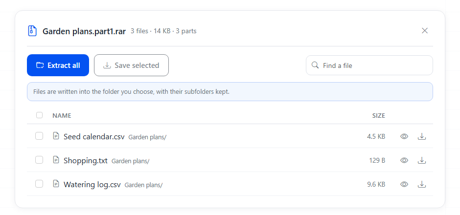

# Check a split RAR set before you unpack it

A big download often comes as `name.part1.rar`, `name.part2.rar` and so on, or in the older style `name.rar`, `name.r00`, `name.r01`. If one piece is missing, still downloading or cut short, the error you get later is usually vague. This repository reads the block headers of every part (nothing is unpacked) and tells you:

- which parts are there and which numbers are missing, including a missing last part (the last file you have says the set goes on);
- which part is cut off: no end record, or smaller than the other parts;
- a part that was renamed (the number in its header does not match the name), a web page saved with a `.rar` name, a `.crdownload` that never finished;
- which file to open first;
- if the set is incomplete, which stored files still sit entirely inside the parts you have, and which need the missing data.

Node 18 or later, no dependencies. Scripts under the MIT license.

```sh
npm test
npm run example
node scripts/check-set.js ~/Downloads            # every set in the folder
node scripts/check-set.js "Trip.part2.rar"       # only the set this part belongs to
node scripts/check-set.js ~/Downloads --json
```

Exit code 0 means every set is complete, 1 means something is missing or broken, 2 is a usage error.

## Example

`examples/` holds the same small set four times: `complete`, `old-style` (RAR4 with `.r00` names), `missing-part` (part 2 deleted) and `cut-download` (part 2 cut to 2600 bytes). The content is made up: garden notes and two generated tables. `scripts/make-examples.js` rebuilds them with the command-line RAR from WinRAR.

```text
$ node scripts/check-set.js examples/missing-part
Set "Garden plans": 2 files
  Garden plans.part1.rar            5120 bytes  RAR5  goes on in the next part
  Garden plans.part3.rar            5072 bytes  RAR5  last part
Not complete:
  - missing part: 2
Can still be taken out: Garden plans/Seed calendar.csv, Garden plans/Shopping.txt
Need the missing data: Garden plans/Watering log.csv
```

The old naming style reads the same way:

```text
$ node scripts/check-set.js examples/old-style
Set "Garden plans": 3 files
  Garden plans.rar                  5120 bytes  RAR4  goes on in the next part
  Garden plans.r00                  5120 bytes  RAR4  goes on in the next part
  Garden plans.r01                  4831 bytes  RAR4  last part
Complete. Open Garden plans.rar and keep the other parts in the same folder.
```

"Can still be taken out" only holds for a normal archive. In a solid archive every file depends on the data before it, so the script says so instead of listing files. Archives with encrypted file names are checked by their parts only.

## Opening the set

When the check is clean, the set still has to be unpacked. Try it here: [Unrar files](https://toolster.net/unrar_files). Select all parts at once and the list appears without unpacking anything; then save one file or extract everything into a folder. This is `examples/complete` opened there:



Video: [opening a RAR file without WinRAR](https://youtu.be/9nMlA9GsLi8).

## More

The same tool in [Russian](https://ru.toolster.net/unrar_files) and [Spanish](https://es.toolster.net/unrar_files), and the rest of [Toolster](https://toolster.net). We make Toolster; this repository is a separate helper and does not contain the code of the site.
